<div align="center">

<!-- Animated DJ Stage & Gold Lightning Header -->


<br/>

<a href="https://github.com/adhilNuckz">
  
</a>

</div>

<br/>

<div align="center">

[](mailto:mikeadhil2002@gmail.com)
[](https://linkedin.com/in/adhilmk)
[](https://adhilmk.nighttime.online)

</div>

<br/>

<div align="center">
  
</div>

<br/>

<table align="center" border="0">
<tr>
<td width="60%" valign="top">

### ⚡ `whoami`

Final-year Computer Science undergraduate (Eastern University of Sri Lanka) and self-taught full-stack builder who prefers shipping deployed, working systems over theoretical exercises. Comfortable owning a project end-to-end — from the codebase to the VPS it lives on.

Background spans **full-stack web development**, **Linux systems administration**, and **cloud/DevOps pipelines**, with production-facing work built under real deadlines.

```yaml
role: Software Engineer / Full-Stack Developer
vibe: High-Voltage Systems & Late-Night Deployments
focus: [Web Development, Systems Infra, DevOps]
currently_learning: [Networking, Cybersecurity, Advanced App Dev]
status: Actively seeking Software Engineering internships
